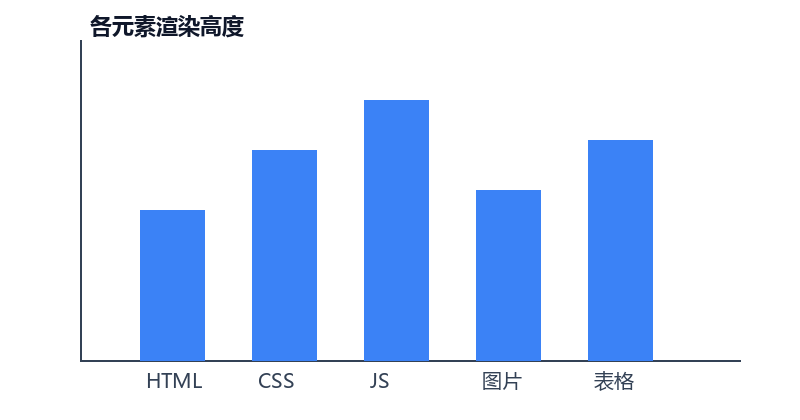

这篇文章专门用来测试各种 Markdown 元素，尤其是**表格**和**图片**。

## 表格

| 元素 | 是否支持 | 备注 |
| --- | --- | --- |
| 文字 | 是 | 基础 |
| 图片 | 是 | 构建时自动优化 |
| 表格 | 是 | 就是这张 |
| 代码块 | 是 | Shiki 语法高亮 |

窄屏下表格应该可以横向滚动，而不是把整个页面撑破。

## 图片



图片下方的说明文字可留可不留，看个人习惯。

## 代码高亮

```js
const posts = await getCollection('blog');
const sorted = posts.sort((a, b) => b.data.pubDate - a.data.pubDate);
```

```css
.prose {
  line-height: 1.85;
}
```

## 任务列表

- [x] 文字
- [x] 图片
- [x] 表格
- [ ] 评论（下一阶段）

## 长段落测试

这是一段较长的文字，用来观察中文的行高和段落间距是否舒服。中文排版和英文不同，行高通常要更大一些，段落之间也需要更明显的间隔。如果行高太紧，读起来会觉得拥挤；如果太松，又会影响信息密度。一般正文行高控制在 1.75 到 1.9 之间比较合适。

这是一段较长的文字，用来观察中文的行高和段落间距是否舒服。中文排版和英文不同，行高通常要更大一些，段落之间也需要更明显的间隔。如果行高太紧，读起来会觉得拥挤；如果太松，又会影响信息密度。一般正文行高控制在 1.75 到 1.9 之间比较合适。
